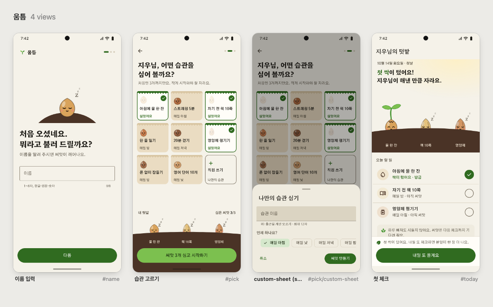
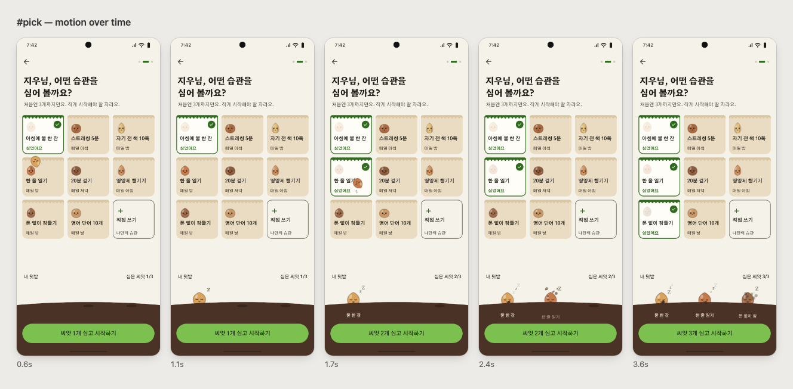
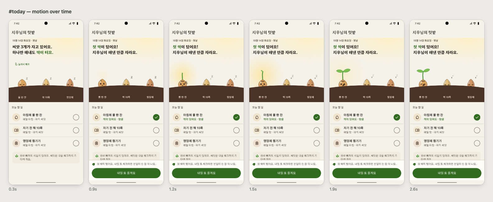

# Android Prototype Skill

[English](README.md) | **한국어**

**안드로이드 네이티브 구조 위에, 앱마다 고유한 모션과 캐릭터 안내를 얹은 표현형 UI 시안을 만드는 Claude Code 스킬**

앱 아이디어를 말하면 클릭되는 HTML 시안을 **흐름 하나씩** 만들어요. 화면마다 승인을 받고, 승인된 결정은 개발용
디자인 노트로 남겨요.



## 특징

- **안드로이드 최적화** — 시스템 뒤로 가기, 하단 내비게이션, 48dp 터치 영역, 권한 흐름 같은 플랫폼 규칙을 지켜요.
  승인된 흐름마다 Compose 구현 메모(RenderEffect, AGSL, Canvas, API 레벨별 대체 방법)를 `DESIGN_NOTES.md`에 남겨서
  시안이 그대로 개발로 이어져요.
- **표현형 UI** — 흐름마다 앱의 핵심 로직을 은유하는 **시그니처 장면**을 하나씩 넣어요. 이름을 쓰면 깨어나
  글자를 눈으로 따라오는 씨앗, 체크하면 싹이 트는 텃밭, 불리한 규칙을 대화로 풀어주는 캐릭터처럼 모션과 캐릭터
  안내로 "설명하지 않고 느끼게" 해요.
- **AI 느낌 제거** — 보라색 기본값, 이모지 아이콘, 인사말 + 통계 카드, 카드 남발, 스와이프 캐러셀 온보딩처럼
  "AI가 만든 앱" 패턴을 금지 목록과 자동 검사로 걸러내요.

## 어떻게 동작하나요

| 단계 | 하는 일 |
|---|---|
| 1. 흐름 지도 | 아이디어를 4–8개 흐름으로 나눠요 |
| 2. 시각 언어 | 레퍼런스에서 원리를 뽑아요 |
| 3. 흐름 콘셉트 | 흐름마다 시그니처 장면 1개 |
| 4. 제작 | 클릭되는 HTML 시안 |
| 5. 검증 | 레이아웃 검사 · 스크린샷 · 모션 필름스트립 |
| 6. 승인 | 승인하면 디자인 노트 기록 후 다음 흐름, 피드백이면 4로 |

- **한 번에 한 흐름.** 화면 12개를 얕게 만드는 대신, 흐름 하나(3–5화면)를 끝까지 완성하고 승인을 받아요.
- **요청이 막연하면 먼저 제안해요.** 방향 2–3개와 시그니처 후보를 짧게 보내고, 질문은 3개 이하로 해요.
  요청이 구체적이면(레퍼런스, 원하는 장면) 바로 만들어요.
- **직접 보고 확인해요.** headless Chrome으로 모든 화면을 열어서 넘침, 겹침, 대비, 터치 영역, 동작 없는 버튼,
  도달할 수 없는 화면을 검사해요. 모든 화면은 스크린샷을 찍고, 모션은 시간대별 필름스트립으로 확인해요.

## 예시

### 습관 트래커 '움틈' — 첫 실행 흐름

> "습관 트래커 앱… 각 화면은 내 승인 받고 넘어갈 거니까 html로. 첫 실행 흐름만: 이름 입력 → 습관 고르기 → 첫 체크.
> rive.app 의 살아있는 캐릭터 모션에서 영감 받고 싶어. 습관을 고르면 작은 씨앗들이 화면에 심어지고, 첫 체크를 하면
> 그게 싹트는 느낌이었으면 좋겠어."

Rive에서는 그림이 아니라 **원리**(캐릭터는 입력에 반응하는 상태 머신)를 가져왔어요.

이름 입력 — 자던 씨앗이 깨어나 글자를 눈으로 따라오고, 이름이 맞으면 웃어요. 회색 비활성 버튼 대신 캐릭터 반응으로
상태를 알려줘요:


습관 고르기 — 습관 하나가 씨앗 봉투 하나예요. 고르면 씨앗이 포물선을 그리며 날아가 흙에 박혀요:



첫 체크 — 씨앗이 깨어나고, 껍질이 갈라지고, 햇빛이 번지고, 떡잎이 펴져요:



시안 원본, 스크린샷, 디자인 노트(결정 이유, 수치, Rive / Compose 구현 메모) 전체:
[`skills/android-prototype/examples/umteum/`](skills/android-prototype/examples/umteum/)

### 막연한 요청에는 먼저 제안해요

"반려견 산책 기록 앱 시안 만들어줘"라고만 하면, 바로 만들지 않고 이렇게 답해요 (실제 결과 일부):

> **관점:** 강아지 산책은 달리기와 달라요. 거리나 속도보다 **멈춰서 냄새 맡는 시간**이 중요해요.
>
> **시그니처 장면 후보** — ① **킁킁 지점** ← 추천: 강아지가 멈추면 경로 위에 잉크 방울이 번지듯 원이 커지고,
> 산책이 끝나면 "오늘 킁킁 7곳 · 18분"으로 모여요. ② **산책 도장**: 경로가 도장 모양으로 줄어 달력에 '쾅'.
> ③ **리드줄 버튼**: 길게 누르면 리드줄이 채워지며 산책 시작.
>
> 방향 3개(산책 수첩 / 동네 지도 / 말랑)와 질문 3개를 함께 보내고, 고르면 첫 흐름을 만들어요.

## 측정 결과

같은 요청을 스킬 버전별로 실행해서 채점했어요 (`evals/evals.json`).

| 테스트 | 이 스킬 (v2) | 이전 버전 (v1) |
|---|---|---|
| 구체적인 요청 (레퍼런스 + 장면 묘사) | **8/8** — 요청한 흐름 완성, 모션 프레임 검증 | 5/8 — 방향 3개만 만들고 멈춤, 모션 미검증 |
| 막연한 요청 ("반려견 산책 기록 앱 시안") | **5/5** — 관점·방향·시그니처 후보 제안 | 1/5 — 일반 질문 4개 |
| 기존 시안 이어서 하기 | **7/7** — 같은 디자인 언어로 다음 흐름 | 5/7 — 모션 미검증, 승인 전 기록 |
| **합계** | **100%** | **51%** |

스킬 없이 같은 요청을 했을 때와 비교한 1차 측정에서는 64% → 100%였어요. 스킬 없이 만들면 이모지 아이콘, 일부
화면만 확인, 체크포인트 없이 끝까지 만들기 같은 문제가 반복됐어요.

## 토큰 사용량 안내

**이 스킬은 토큰을 많이 써요.** 문서를 읽고, 100KB 안팎의 HTML을 쓰고, 스크린샷과 모션 프레임을 이미지로 확인하고,
문제를 고친 뒤 다시 검사하는 과정을 반복하기 때문이에요. 품질을 위해 일부러 그렇게 설계했어요.

eval에서 측정한 실제 사용량이에요 (Claude Opus, 작업 1회 기준, 스킬 문서 읽기 포함):

| 작업 | 토큰 | 시간 |
|---|---|---|
| 막연한 요청 → 방향 제안까지 (화면 제작 없음) | 약 5만 | 약 1–2분 |
| 흐름 1개 제작 + 검증 (3–4화면, 시그니처 모션 포함) | 약 15만–18만 | 약 10–13분 |
| 기존 시안에 다음 흐름 추가 | 약 15만 | 약 10분 |
| 참고: 스킬 없이 같은 흐름 제작 | 약 7만–10만 | 약 5–9분 |

같은 작업을 스킬 없이 하면 토큰은 덜 들지만, 검증이 빠지고 결과물 품질이 떨어져요. 그래도 아끼고 싶다면:

- **요청을 구체적으로 하세요.** 레퍼런스와 원하는 장면을 말하면 제안 단계를 건너뛰어요.
- **흐름 사이에 대화를 비우세요 (`/clear`).** 결정은 `DESIGN_NOTES.md`에 남아 있어서, 새 대화에서도 이어서 만들어요.
- **정적인 화면은 모션 검증을 생략해 달라고 하세요.** 필름스트립 이미지를 읽는 데 토큰이 들어요.
- **수정 요청은 모아서 한 번에 하세요.** 수정할 때마다 검사와 스크린샷이 다시 돌아요.
- **간단한 수정은 더 가벼운 모델로 하세요.** 새 흐름의 콘셉트를 잡을 때만 상위 모델을 쓰면 돼요.

## 설치

Claude Code에서:

```
/plugin marketplace add jun-works/android-prototype-skill
/plugin install android-prototype@android-prototype-skill
```

또는 직접 복사:

```bash
git clone https://github.com/jun-works/android-prototype-skill
cp -R android-prototype-skill/skills/android-prototype ~/.claude/skills/
```

**필요한 것:** Python 3.8 이상(추가 패키지 없음), Google Chrome(또는 Chromium/Edge/Brave). 아이콘과 폰트를 Google
Fonts에서 불러오기 때문에 인터넷 연결이 필요해요.

## 사용법

그냥 말하면 돼요:

```
앱 아이디어가 있어. 동네 빵집 마감 할인 알림 앱이야. 인터랙티브 시안 만들어줘.
```

```
습관 트래커 시안 이어서 해줘. 첫 실행 흐름은 승인됐어. 다음은 알림 권한 흐름.
```

```
첫 실행 흐름만 만들어줘: 이름 입력 → 관심사 고르기 → 첫 추천.
종이가 접혔다 펼쳐지는 느낌의 모션이면 좋겠어.
```

## 구성

| 경로 | 내용 |
|---|---|
| `skills/android-prototype/SKILL.md` | 작업 방식 전체 (모드, 단계, 금지 목록, 메시지 형식) |
| `references/signature-moments.md` | 시그니처 장면 찾는 법, 패턴, 경쟁 앱 테스트 |
| `references/inspiration.md` | 레퍼런스에서 원리만 뽑아 다시 구현하는 법 |
| `references/motion-recipes.md` | 검증된 모션 레시피 (liquid 필터, 구체 파티클, 캐릭터, 대화 시퀀스) + Android 매핑 |
| `references/android-ui.md` | 안드로이드다움: 내비게이션, 컴포넌트 선택, 수치, iOS 습관 제거, 한국 앱 관례 |
| `references/components.md` | 시안 셸의 마크업, 인터랙션 속성, App API |
| `references/visual-directions.md` | 방향 축, 팔레트, 한글 서체 조합 |
| `references/review-checklist.md` | 검사 결과 고치는 법, 스크린샷·모션 검수 기준 |
| `assets/shell.css`, `shell.js` | 폰 프레임, 라우터, M3 기반 컴포넌트, 모션 헬퍼, 레이아웃 검사기 |
| `scripts/proto.py` | `new` · `palette` · `check` · `frames` · `board` · `build` · `audit` · `shots` |
| `examples/umteum/` | 승인된 흐름 예시: 시안, 스크린샷, 모션, 디자인 노트 |

### 도구

```bash
proto.py new app/app.src.html --name "앱 이름"     # 시안 + DESIGN_NOTES.md 생성
proto.py palette --seed "#c23d22" --write app/app.src.html   # 색 역할 전체 생성 (대비 보장)
proto.py check app/app.src.html                     # 빌드 → 레이아웃 검사 → 모든 화면 스크린샷
proto.py frames app/app.src.html --screen splash --at 0.2 0.8 1.6 3   # 모션 필름스트립
```

결과물은 HTML 파일 하나라서 브라우저나 폰에서 바로 열려요. Esc나 왼쪽 가장자리 스와이프가 뒤로 가기예요.

## 한계

- 시안이에요. 상태는 메모리에만 있고, 실제 권한·사진·서버 연결은 흉내만 내요.
- 웹에서 구현한 모션은 실제 안드로이드 구현과 다를 수 있어요. 기기에서 확인할 점은 DESIGN_NOTES에 남겨요.

## 라이선스

MIT
