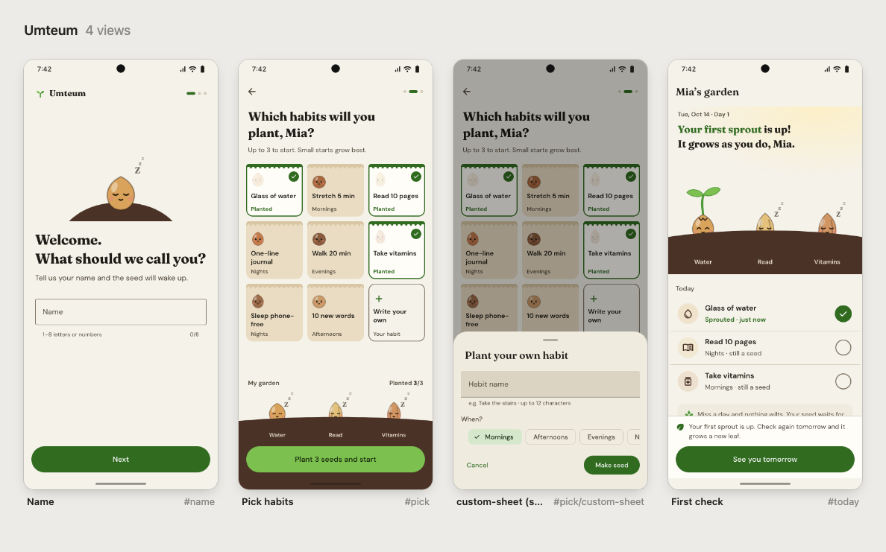
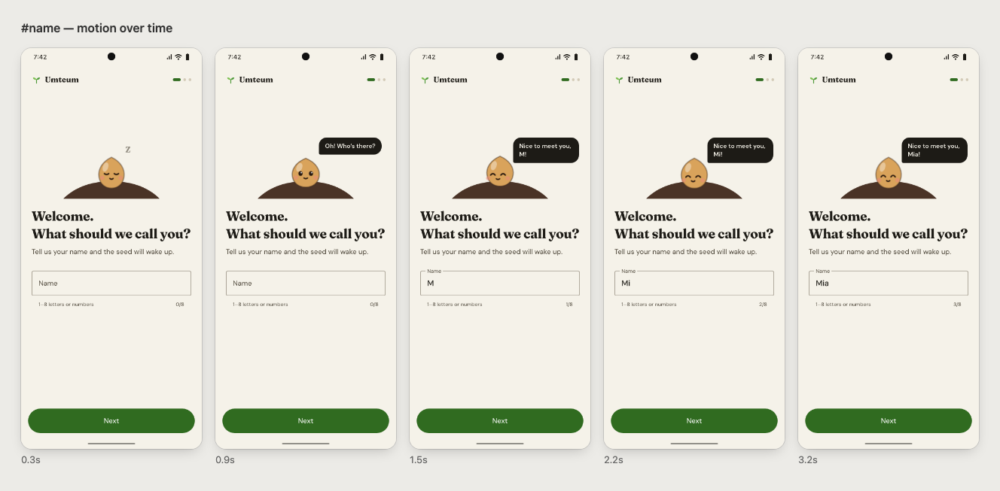
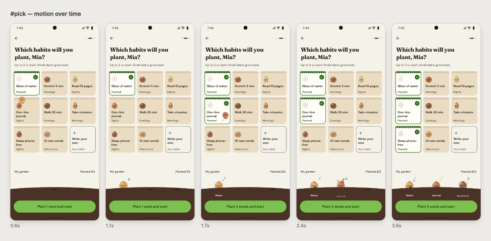

# Android Prototype Skill

**English** | [한국어](README.ko.md)

**A Claude Code skill that designs expressive Android app UI prototypes — native Android structure, with motion and
character guides unique to each app.**

Describe an app idea and get a clickable HTML prototype, built **one flow at a time**. Each flow is approved before the
next, and every approved decision is written down as design notes for development.



## Features

- **Built for Android** — follows platform rules: system back, bottom navigation, 48dp touch targets, permission
  flows. Every approved flow gets Compose implementation notes in `DESIGN_NOTES.md` (RenderEffect, AGSL, Canvas,
  per-API-level fallbacks), so the prototype carries straight into development.
- **Expressive UI** — each flow gets one **signature moment** that makes the app's core idea felt: a seed that wakes
  up and follows your letters as you type your name, a garden that sprouts when you check a habit, characters that
  explain an unwelcome rule in a chat. Motion and character guides show instead of explain.
- **Doesn't look AI-made** — the usual "generated app" patterns (default purple, emoji icons, greeting + stat cards,
  cards everywhere, swipe-carousel onboarding) are blocked by a red-flag list and automated checks.

## How it works

| Step | What happens |
|---|---|
| 1. Flow map | The idea becomes 4–8 flows |
| 2. Visual language | Principles extracted from your reference |
| 3. Flow concept | One signature moment for the flow |
| 4. Build | Clickable HTML prototype |
| 5. Verify | Layout audit · screenshots · motion filmstrips |
| 6. Approval | You approve (→ notes, next flow) or give feedback (→ back to 4) |

- **One flow at a time.** Instead of twelve shallow screens, one flow (3–5 screens) is finished properly and approved.
- **Vague request? It proposes first.** 2–3 directions and signature-moment ideas in a short message, at most three
  questions. A specific request (a reference, described scenes) gets built right away.
- **It looks at its own work.** Headless Chrome opens every screen and checks for overflow, overlap, contrast, tap
  targets, dead buttons and unreachable screens. Every screen is screenshotted; motion is checked as a filmstrip over time.

## Examples

### Habit tracker "Umteum" — first-run flow

> "A habit tracker… I'll approve each screen before the next, so make it in HTML. Just the first-run flow: name →
> pick habits → first check. Inspired by the living character motion on rive.app. When I pick habits, little seeds
> get planted, and the first check should feel like one sprouting."

From Rive it took the **principle**, not the look: a character is a state machine that reacts to input.

Name — a sleeping seed wakes up, follows your letters with its eyes and smiles when the name is valid. The character's
reaction replaces a grey disabled button:



Pick habits — each habit is a seed packet. Pick one and its seed flies in an arc and lands in the soil:



First check — the seed wakes, its shell cracks, light swells behind it and two leaves unfurl:


Source, screenshots and full design notes (reasons, numbers, Rive / Compose implementation):
[`skills/android-prototype/examples/umteum/`](skills/android-prototype/examples/umteum/). Shown here in English; the
original Korean version (the request was in Korean) sits alongside it with the same design and motion.

### A vague request gets a proposal first

Asked only "make a prototype for a dog-walk logging app", it doesn't start building. It replies (excerpt, translated):

> **Angle:** a dog walk isn't a run. What matters isn't distance or pace but **the time spent stopping to sniff**.
>
> **Signature-moment ideas** — ① **Sniff spots** ← recommended: when the dog stops, a circle spreads on the route like
> an ink drop, growing the longer it stays; at the end they gather into "7 sniff spots · 18 min today". ② **Walk stamp**:
> the route shrinks into a stamp and thumps onto the calendar. ③ **Leash button**: long-press fills a leash to start.
>
> Plus three directions and three questions; once you pick, it builds the first flow.

## Measured results

The same requests were run against each version of the skill and graded (`evals/evals.json`).

| Test | This skill (v2) | Previous version (v1) |
|---|---|---|
| Specific request (reference + described scenes) | **8/8** — built the requested flow, verified motion frame by frame | 5/8 — made 3 directions and stopped, motion unverified |
| Vague request ("dog-walk logging app") | **5/5** — angle, directions, signature ideas | 1/5 — four generic questions |
| Continuing an existing prototype | **7/7** — next flow in the same design language | 5/7 — motion unverified, recorded before approval |
| **Total** | **100%** | **51%** |

An earlier run against no skill at all scored 64% → 100%. Without the skill: emoji icons, only some screens checked,
and full builds with no checkpoint.

## Token usage

**This skill uses a lot of tokens.** It reads its docs, writes ~100KB of HTML, looks at screenshots and motion frames
as images, then fixes and re-checks. That's deliberate — it's how the quality is reached.

Measured in the evals (Claude Opus, one task, including reading the skill's docs):

| Task | Tokens | Time |
|---|---|---|
| Vague request → proposal only (no screens built) | ~50k | ~1–2 min |
| One flow built and verified (3–4 screens with signature motion) | ~150k–180k | ~10–13 min |
| Adding the next flow to an existing prototype | ~150k | ~10 min |
| For reference: same flow without the skill | ~70k–100k | ~5–9 min |

Without the skill it's cheaper, but verification is skipped and the result is weaker. To save tokens anyway:

- **Be specific.** A reference and the scenes you want skip the proposal step.
- **Clear the conversation between flows (`/clear`).** Decisions live in `DESIGN_NOTES.md`, so a new conversation picks up where you left off.
- **Ask to skip motion checks for static screens.** Reading filmstrip images costs tokens.
- **Batch your change requests.** Every round of changes re-runs the audit and screenshots.
- **Use a lighter model for small edits.** Save the top model for new flow concepts.

## Install

In Claude Code:

```
/plugin marketplace add jun-works/android-prototype-skill
/plugin install android-prototype@android-prototype-skill
```

Or copy it yourself:

```bash
git clone https://github.com/jun-works/android-prototype-skill
cp -R android-prototype-skill/skills/android-prototype ~/.claude/skills/
```

**Requirements:** Python 3.8+ (no extra packages) and Google Chrome (or Chromium / Edge / Brave). Icons and fonts load
from Google Fonts, so an internet connection is needed.

## Usage

Just ask:

```
I have an app idea: last-minute discount alerts from neighbourhood bakeries. Make me an interactive prototype.
```

```
Continue the habit tracker prototype. The first-run flow is approved — next is the notification permission flow.
```

```
Only the first-run flow: name → pick interests → first recommendation.
I want the motion to feel like paper folding and unfolding.
```

The prototype's UI copy follows your language — ask in Korean and you get a Korean UI.

## What's inside

| Path | Contents |
|---|---|
| `skills/android-prototype/SKILL.md` | The whole method: modes, phases, red flags, message format |
| `references/signature-moments.md` | Finding a signature moment, patterns, the competitor test |
| `references/inspiration.md` | Extracting principles from a reference and rebuilding them |
| `references/motion-recipes.md` | Verified motion recipes (liquid filter, orb sphere, characters, chat sequences) + Android mapping |
| `references/android-ui.md` | Android-ness: navigation, choosing components, metrics, removing iOS habits, Korean app conventions |
| `references/components.md` | The prototype shell's markup, interaction attributes, App API |
| `references/visual-directions.md` | Direction axes, palettes, type pairings (incl. Korean) |
| `references/review-checklist.md` | Fixing audit findings, reviewing screenshots and motion |
| `assets/shell.css`, `shell.js` | Phone frame, router, Material 3-based components, motion helpers, layout auditor |
| `scripts/proto.py` | `new` · `palette` · `check` · `frames` · `board` · `build` · `audit` · `shots` |
| `examples/umteum/` | An approved flow: prototype, screenshots, motion, design notes |

### Tools

```bash
proto.py new app/app.src.html --name "My App"            # prototype + DESIGN_NOTES.md
proto.py palette --seed "#c23d22" --write app/app.src.html   # all colour roles, contrast-safe
proto.py check app/app.src.html                          # build → layout audit → screenshot every screen
proto.py frames app/app.src.html --screen splash --at 0.2 0.8 1.6 3   # motion filmstrip
```

The result is a single HTML file that opens in a browser or on a phone. Esc or a swipe from the left edge goes back.

## Limits

- It's a prototype: state lives in memory; permissions, photos and servers are simulated.
- Web motion can differ from the final Android implementation; things to check on a device go into DESIGN_NOTES.

## License

MIT
