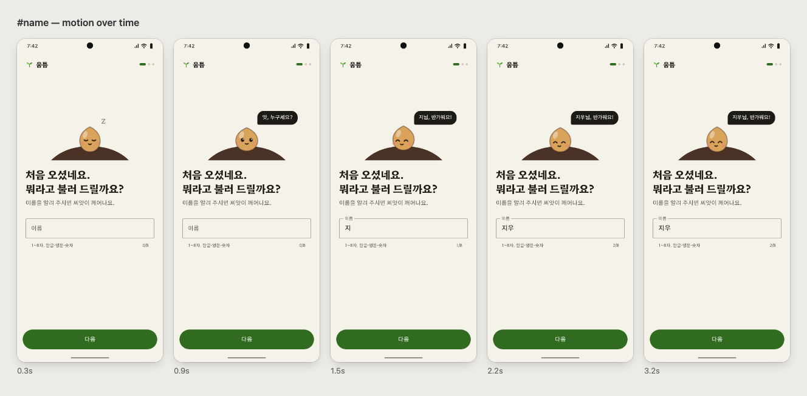

# Example — 움틈 첫 실행 흐름

[English](README.md) | **한국어**

움틈(가칭)은 습관 하나를 텃밭의 씨앗 하나로 키우는 습관 트래커예요. 이 폴더는 이 스킬로 만든 첫 실행 흐름이고,
결과뿐 아니라 **방법**을 보여 주려고 넣었어요.

시안은 두 언어로 있어요. `app.html`(한국어, 원래 요청)과 `app.en.html`(영어). 디자인과 모션은 같고, 영어판은 한글 서체 대신
Fraunces + DM Sans를 써요.

## 요청

> 습관 트래커 앱을 만들려고 해. 인터랙티브 시안부터 확정하고 개발 들어갈 거야. 각 화면은 내 승인 받고 다음으로
> 넘어갈 거니까 시안은 html로 만들어줘. 일단 첫 실행 흐름만: 이름 입력 → 만들고 싶은 습관 고르기 → 첫 체크 완료까지.
> https://rive.app 의 살아있는 캐릭터 모션에서 영감 받고 싶어. 습관을 고르면 작은 씨앗들이 화면에 심어지고, 첫 체크를
> 하면 그게 싹트는 느낌이었으면 좋겠어.

이 요청이 좋은 결과로 이어진 이유이자, 스킬이 기본으로 하는 일:

| 요청에 있던 것 | 스킬의 원칙 |
|---|---|
| "각 화면은 내 승인 받고" | 흐름 하나씩, 승인 후 다음 |
| "rive.app 에서 영감" | 레퍼런스에서 **원리**만 추출 (캐릭터 = 입력에 반응하는 상태 머신) |
| "씨앗이 심어지고 … 싹트는 느낌" | 시그니처 장면 — 습관 = 씨앗, 체크 = 성장이라는 앱의 약속을 모션으로 |
| "첫 실행 흐름만" | 범위를 좁혀 3화면을 끝까지 완성 |

## 흐름

| 화면 | 시그니처 / 결정 |
|---|---|
| 이름 입력 | 자던 씨앗이 입력하면 깨어나 글자를 눈으로 따라오고, 이름이 맞으면 웃어요. 회색 비활성 버튼 대신 캐릭터 반응으로 상태를 알려요 |
| 습관 고르기 | 습관 = 크라프트 씨앗 봉투. 고르면 씨앗이 포물선으로 날아가 흙에 박히고, 빼면 튀어나와요. 처음엔 3개까지 |
| 첫 체크 | 씨앗이 깨어나고 → 껍질이 갈라지고 → 햇빛이 번지고 → 떡잎이 펴져요. "하루 빠져도 시들지 않아요"로 걱정에 먼저 답해요 |

`proto.py frames`로 확인한 모션:

## 파일

| 파일 | 내용 |
|---|---|
| `app.src.html` · `app.en.src.html` | 원본, 한국어 · 영어 (`../../assets/shell.*`을 링크, `proto.py build`가 하나로 합침) |
| `app.html` · `app.en.html` | 빌드본 — 브라우저나 폰에서 바로 열려요 |
| `DESIGN_NOTES.md` | 결정과 이유, 씨앗 상태 머신의 수치, Android(Rive / Compose) 구현 메모, 데이터 메모 |
| `shots/`, `*-frames.png` · `shots-en/`, `*-frames.en.png` | 스크린샷과 모션 필름스트립, 한국어 · 영어 |

다시 빌드하고 검사하기: `python3 ../../scripts/proto.py check app.src.html --out shots`
