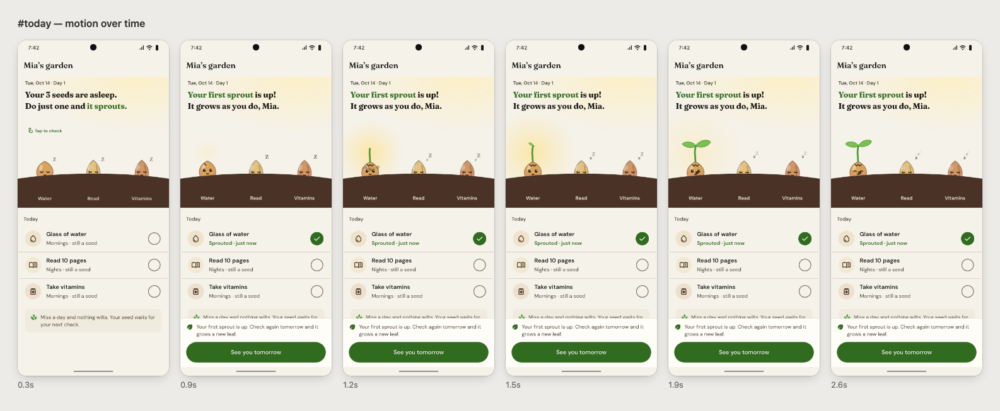

# Example — Umteum first-run flow

**English** | [한국어](README.ko.md)

Umteum (working name; Korean for "sprouting") is a habit tracker where each habit grows as a seed in your garden. This
folder is its first-run flow, built with this skill. It's here to show the **method**, not just the result.

The prototype comes in two languages: `app.en.html` (English) and `app.html` (Korean — the original request was in
Korean, so the design notes are too). Same design, same motion; English uses Fraunces + DM Sans in place of the
Korean typefaces.

## The request

> (translated) I'm building a habit tracker. I want to settle the interactive prototype before development. I'll
> approve each screen before moving on, so make the prototype in HTML. Just the first-run flow: name → pick the habits
> you want → finish the first check. I'd like inspiration from the living character motion on https://rive.app. When I
> pick habits, little seeds should get planted on screen, and the first check should feel like one sprouting.

Why this request led to a strong result — and what the skill now does by default:

| In the request | Skill principle |
|---|---|
| "approve each screen before moving on" | One flow at a time, approved before the next |
| "inspiration from rive.app" | Extract the **principle** from the reference (a character is a state machine that reacts to input) |
| "seeds get planted … first check sprouts" | A signature moment: habit = seed, check = growth — the app's promise as motion |
| "just the first-run flow" | Narrow scope: three screens, finished properly |

## The flow

| Screen | Signature / decision |
|---|---|
| Name | A sleeping seed wakes as you type, follows your letters with its eyes and smiles when the name is valid — the character's reaction replaces a grey disabled button |
| Pick habits | Each habit is a kraft seed packet. Pick one and its seed flies in an arc and lands in the soil; un-pick and it pops out. Three at most to start |
| First check | The seed wakes → its shell cracks → light swells → two leaves unfurl. "Missing a day won't wilt it" answers the streak worry up front |

Motion, as checked with `proto.py frames`:

## Files

| File | What |
|---|---|
| `app.en.src.html` · `app.src.html` | Sources, English · Korean (link `../../assets/shell.*`; `proto.py build` inlines them) |
| `app.en.html` · `app.html` | Built, self-contained — open in a browser or on a phone |
| `DESIGN_NOTES.md` | Decisions and reasons, the seed state machine's numbers, Android (Rive / Compose) implementation notes, data notes (Korean) |
| `shots-en/`, `*-frames.en.png` · `shots/`, `*-frames.png` | Screenshots and motion filmstrips, English · Korean |

Rebuild and re-check: `python3 ../../scripts/proto.py check app.en.src.html --out shots-en`
